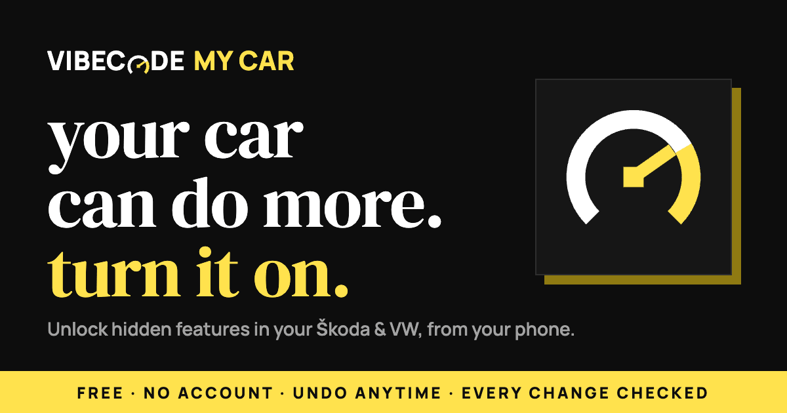

<p align="center">
  
</p>

# Vibecode my car

**Unlock the features already built into your Škoda or Volkswagen — from your phone, in the browser.**

Many cars sold in India leave the factory with features switched off in software: lane-change blinks,
needle sweep, tail lights with DRL, mirror dip on reverse, and more. Vibecode my car turns them on over a
Bluetooth OBD adapter. No app install, no account, no workshop visit.

**Try it:** [vibecodemycar.pages.dev](https://vibecodemycar.pages.dev)

> Not affiliated with Škoda, Volkswagen or any coding-tool vendor. Changing your car's settings is done at your
> own risk. Read [Safety](#safety) before you start.

---

## What it does

1. **Pick your car** — brand and model. Year, trim and instrument cluster are read from the car when it connects.
2. **Pick a feature** — 141 for a Kushaq, grouped as lights, dash, locks, assist and comfort.
3. **Connect** a Bluetooth OBD adapter in the car's OBD port (ignition on, engine off).
4. **It does the rest**, step by step on screen:
   - checks it is your car (VIN) and the right control unit (part number)
   - **saves your original setting first**, on your phone
   - writes the change
   - **reads it back** to confirm the car accepted it
5. **Undo** any change later with one tap: the saved original is written back the same way.

## Supported cars

| Brand | Models |
|---|---|
| Škoda | Kodiaq, Kushaq, Kylaq, Octavia RS, Slavia, Superb |
| Volkswagen | Golf GTI, Taigun, Tayron, Tiguan, Virtus |

Any other Škoda or VW: pick **Other model**. The app reads the car's platform (MQB, MQB-A0-IN, PQ) when it
connects and offers what its sister cars share. Not every feature is codable yet:
[docs/FEATURE_COVERAGE.md](docs/FEATURE_COVERAGE.md) lists what is and isn't, per car.

**Your car isn't here, or a feature doesn't work on it?** That's exactly where help is needed —
see [Contributing](#contributing).

## What you need

- **A phone or computer with Chrome or Edge** (Android, Windows, macOS, Linux). iPhone browsers can't use
  Bluetooth from a web page yet.
- **A Bluetooth (BLE) OBD adapter.** For *writing* changes, use a genuine one — OBDLink CX / MX+ or vLinker
  MC+. Many cheap ELM327 clones corrupt the last byte of each CAN frame they send: they read fine, but writes
  fail. (We measured this on an "OBDBLE v2.1" clone; see [cars/skoda-kushaq.md](cars/skoda-kushaq.md).)

## Safety

- Every change saves the original first and is checked by reading it back. Nothing is sent until you tap Start.
- Do it parked, ignition on, engine off, with a healthy battery. Don't unplug the adapter or close the page
  while a change is being written.
- Some features change how lights, warnings or assistance systems behave. Check what's legal where you drive.
- A recipe that is wrong for your car can misbehave. If something looks off, undo it and
  [report it](https://github.com/rishabh-bansal/vibecodemycar/issues/new/choose).

## Privacy

- Backups of your original settings stay **on your device** (browser storage).
- **Diagnostic logs are uploaded.** Each connection's adapter log and each coding journal are sent to the
  project's log server (a Cloudflare Worker, [workers/logs](workers/logs)), filed under the car's **VIN**,
  so failures on real cars can be fixed. Control-unit and adapter serial numbers are blanked first. There is
  no on-screen switch to turn this off yet. Details: [docs/DEPLOY.md](docs/DEPLOY.md#diagnostic-logs).

## Contributing

This project grows with the people who use it on their cars. Three ways to help:

| You want to… | Start here |
|---|---|
| **Add a car** (a model or variant that isn't listed) | [docs/contributing/adding-a-car.md](docs/contributing/adding-a-car.md) |
| **Add or fix a feature** (a coding recipe) | [docs/contributing/adding-a-feature.md](docs/contributing/adding-a-feature.md) |
| **Share what you learned** on your car — what worked, what didn't, part numbers, quirks | [docs/contributing/sharing-a-finding.md](docs/contributing/sharing-a-finding.md) and [cars/](cars/) |

No code needed for the third: [open a "Car finding" issue](https://github.com/rishabh-bansal/vibecodemycar/issues/new?template=car-finding.yml).
Read [CONTRIBUTING.md](CONTRIBUTING.md) first — it covers the contribution terms.

## Develop

Node 22 or later.

```bash
npm ci
npm run dev            # http://localhost:5173
npm run check          # typecheck, lint, data check, tests, build — what CI runs
```

Without a car: open `http://localhost:5173/connect?feature=…&scanner=fake` in development to get the in-app
adapter picker against a simulated adapter. Full guide to testing on a real car from a Mac:
[docs/LIVE_TESTING.md](docs/LIVE_TESTING.md).

### Layout

```
src/
  screens/        the app's screens (car, features, connect, coding, done)
  domain/         car catalogue, coding plans and sessions, backups — no browser APIs
  infra/          Bluetooth link and writer, storage, cloud logs
  data/           generated runtime data (app-data.json, catalogue.json)
packages/
  obd-core/       ELM327 / ISO-TP / UDS stack, adapter emulator
  coding/         coding blocks, variant and backup planning
data/source/      recipe sources: overlays, catalogue maps, consumer copy  →  npm run data
cars/             what people learned on each car
workers/logs/     the diagnostic log Worker (Cloudflare Worker + D1)
scripts/live/     the live kit: drive a real car from a terminal
docs/             architecture, data pipeline, live testing, coverage
```

More: [docs/ARCHITECTURE.md](docs/ARCHITECTURE.md) · [docs/DATA.md](docs/DATA.md).

## License

**Source-available, not open source.** © 2026 Rishabh Bansal. You may read the code, run it for your own car,
and contribute changes back here. You may not reuse any part of it — the code, the recipes or the car data — in
another app, product or website, redistribute it, or use it to train or prompt AI models to build something
similar. The full terms are in [LICENSE](LICENSE).

"Škoda" and "Volkswagen" are trademarks of their owners, used here only to say which cars the app works with.
